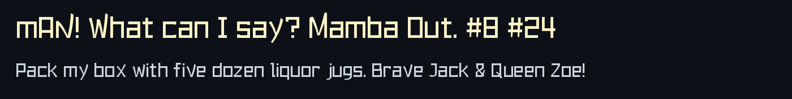
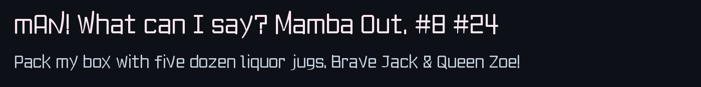
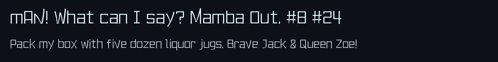
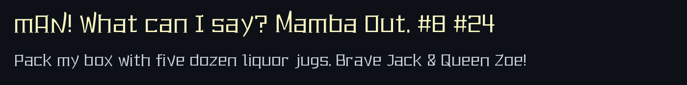

<p align="center">
  <a href="./README.md">简体中文</a> · <a href="./README.zh-TW.md">繁體中文</a> · <b>English</b>
</p>

## Installation

Download `.ttf` files from [**Releases**](../../releases):

- **Windows**: Right-click `.ttf` → **Install**
- **macOS**: Double-click `.ttf` → **Install Font**
- **Linux**: Copy `.ttf` to `~/.local/share/fonts/` and run `fc-cache -fv`

## Fonts

### `Mamba-Mono-Sans-HT`



```text
mAN! What can I say? Mamba Out. #8 #24
Pack my box with five dozen liquor jugs. Brave Jack & Queen Zoe!
```

### `Mamba-Mono-Sans-KT`



```text
mAN! What can I say? Mamba Out. #8 #24
Pack my box with five dozen liquor jugs. Brave Jack & Queen Zoe!
```

### `Mamba-Mono-FS`



```text
mAN! What can I say? Mamba Out. #8 #24
Pack my box with five dozen liquor jugs. Brave Jack & Queen Zoe!
```

### `Mamba-Mono-ST`



```text
mAN! What can I say? Mamba Out. #8 #24
Pack my box with five dozen liquor jugs. Brave Jack & Queen Zoe!
```
